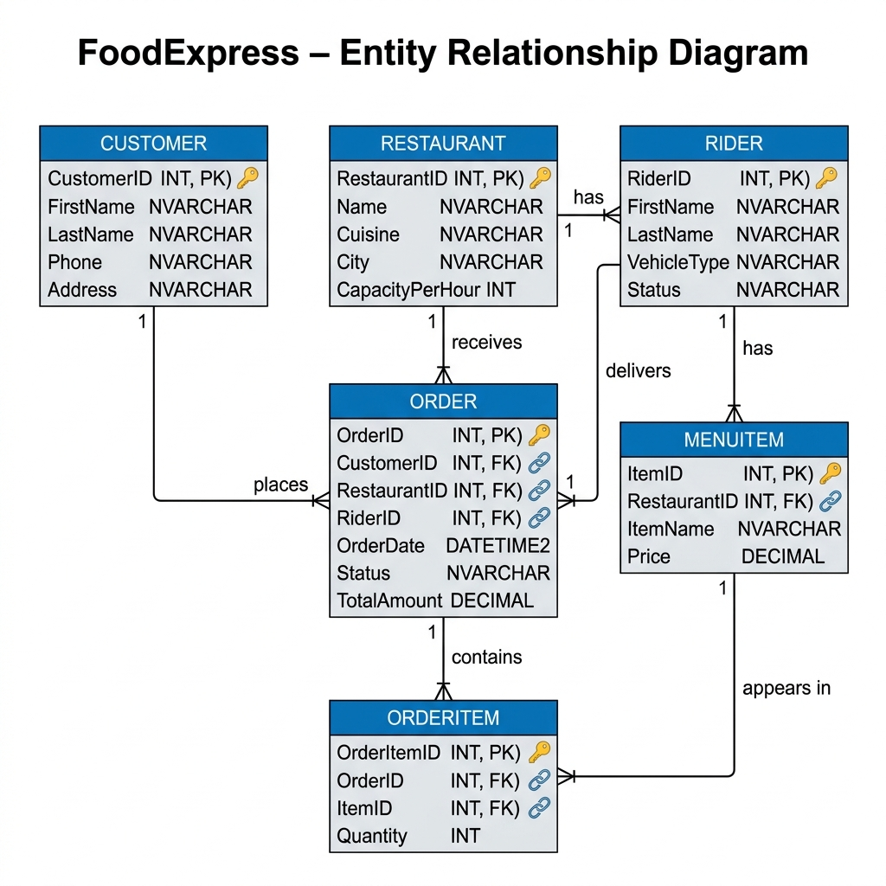
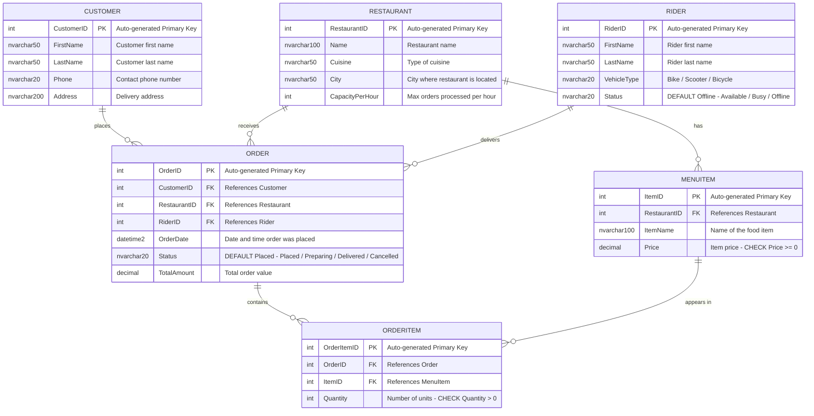

# FoodExpress – Entity Relationship Diagram

## Visual ER Diagram

---

## Mermaid ER Diagram (Text Format)

---

## Entities and Attributes Summary

| Entity | PK | FKs | Key Constraints |
|--------|-----|-----|----------------|
| **Customer** | CustomerID | — | — |
| **Restaurant** | RestaurantID | — | — |
| **MenuItem** | ItemID | RestaurantID | CHECK Price >= 0 |
| **Rider** | RiderID | — | DEFAULT Status = 'Offline' |
| **Order** | OrderID | CustomerID, RestaurantID, RiderID | DEFAULT Status = 'Placed' |
| **OrderItem** | OrderItemID | OrderID, ItemID | CHECK Quantity > 0 |

---

## Relationships Summary

| # | From | To | Cardinality | Relationship Label |
|---|------|----|------------|-------------------|
| 1 | Restaurant | MenuItem | 1 → Many | has |
| 2 | Customer | Order | 1 → Many | places |
| 3 | Restaurant | Order | 1 → Many | receives |
| 4 | Rider | Order | 1 → Many | delivers |
| 5 | Order | OrderItem | 1 → Many | contains |
| 6 | MenuItem | OrderItem | 1 → Many | appears in |

> **Cardinality Notation:** `||--o{` = one-to-many (zero or more on the many side)

---

## Notes

- `Order` is a reserved SQL keyword. The table is named `[Order]` in SQL Server.
- All primary keys use `IDENTITY(1,1)` for automatic generation.
- `OrderItem` is the highest-volume table — designed to hold 200+ rows.
- The ER diagram follows the **crow's foot notation** standard.

---

*FoodExpress | Sprint 1 | Hexaware Training Capstone*
